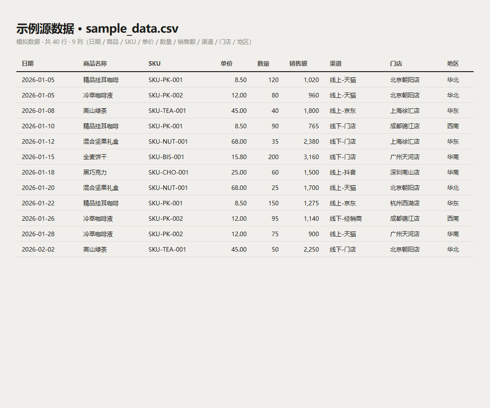
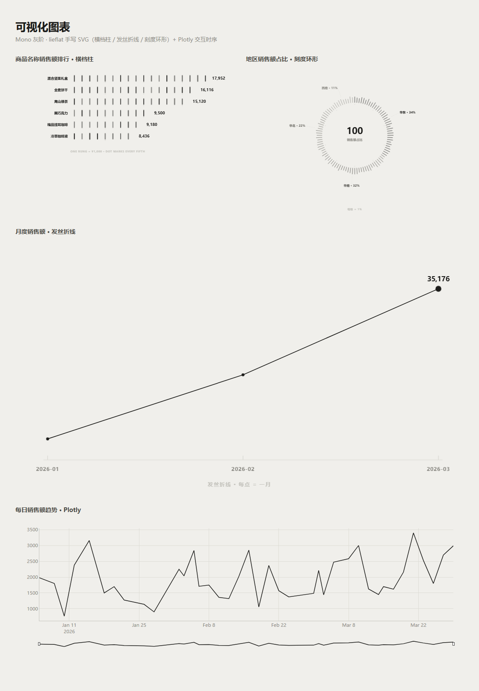

# 经济数据可视化分析系统

> `economic-data-visualization-skill` —— 品牌商品流水「字段识别 → 数据清洗 → 指标计算 → 可视化」全自动多页面 BI。

把一份 Excel / CSV 销售流水丢进来，系统自动识别字段、清洗数据、算好指标，并生成一组 **Mono 灰阶风格**的图表，在 Streamlit 网页里以「首页 / 数据看板 / AI 诊断报告 / 原始数据」四个页面呈现。面向非程序员：不写字段映射、不调图表参数，也能一键出图、直接下载。

---

## 效果图

**源数据（模拟）**



**可视化图表** —— 横档柱 / 发丝折线 / 刻度环形 / 交互时序



---

## 功能特性

- **字段自动识别**：日期、商品、SKU、单价、数量、销售额、渠道、门店、地区、订单号
- **数据清洗**：去重、日期规范化、金额单位归一（元 / 万元 / 亿元）、IQR 异常值标记
- **指标计算**：销售额 / 销量 / 客单价 / 排行 / 占比 / 环比 / 同比
- **图表动态生成**：按数据中实际存在的字段，生成趋势、排行、地区堆叠与占比等
- **图表类型切换**：柱状类图表可在「横档柱 / 柱状图 / 折线图 / 饼图」间切换
- **多页面 BI**：数据看板（钻取筛选 + KPI）、AI 诊断报告（DeepSeek）、原始数据对比
- **所见即所得导出**：清洗后 CSV 与 HTML 报告均浏览器直接下载，文件名带时间戳

## 目标与边界

**目标**

1. **全流程自动化**：读取 → 识别 → 清洗 → 指标 → 图表，无需手写字段映射；
2. **图表好看到能直接发**：lieflat 手写 SVG + 入场动效，纯墨色、无强调色；
3. **导出即所得**：清洗 CSV 与 HTML 报告统一走浏览器下载，带时间戳、不覆盖历史。

**边界（明确不做什么）**

- 示例数据均为**模拟数据**，绝不编造、绝不提交真实业务数据；
- 不做真实业务数据的存储与收集，数据目录与本地资产一律不入库；
- 密钥安全：DeepSeek API Key 只读自 `.streamlit/secrets.toml`，不进源码、不进前端；
- 视觉系统锁定 **Mono 灰阶**，不引入彩色强调色。

**本轮优化（相对初版）**

- 折线图 → lieflat「发丝折线」：描线入场 + 逐点弹入 + 峰值标注，`prefers-reduced-motion` 降级；
- 饼图 → lieflat「刻度环形」：1 格 = 1%，灰阶阶梯分段，中心标注数据说明、外侧「名称 · 占比」；
- 指标明细默认展开，左右两栏画面更平衡；
- 导出统一走浏览器下载：HTML 报告文件名带「筛选 / 全量」标记 + 时间戳。

## 快速开始

### 环境要求

- Python ≥ 3.9
- 依赖见 [requirements.txt](requirements.txt)

### 安装

```bash
pip install -r requirements.txt
```

### 启动

```bash
streamlit run Home.py
```

浏览器打开 <http://localhost:8501>。首页默认加载 `data/sample_data.csv`（模拟数据），可直接体验；也可在「数据看板」左侧「数据源与下载」上传自己的 CSV / Excel。

### 启用 AI 诊断报告（可选）

AI 页接入 DeepSeek。在项目根目录创建 `.streamlit/secrets.toml`（该文件已 `.gitignore`，**绝不提交**）：

```toml
[deepseek]
api_key = "sk-你的密钥"
base_url = "https://api.deepseek.com"
```

保存后重启应用即可。不配置也能正常使用除 AI 诊断外的全部功能。

## 项目结构

```
.
├── Home.py                       # Streamlit 入口（st.navigation 多页面路由）
├── requirements.txt              # Python 依赖
├── README.md
├── SKILL.md                      # Skill 说明（供 AI Agent 使用）
├── LICENSE                       # MIT
├── data/
│   └── sample_data.csv           # 模拟销售流水（仅演示，非真实业务数据）
├── images/                       # README 效果图
│   ├── source-data.png
│   └── charts.png
├── pages/                        # Streamlit 多页面
│   ├── 1_数据看板.py             # 核心图表 + KPI + 钻取筛选
│   ├── 2_AI诊断报告.py           # DeepSeek 智能诊断
│   └── 3_原始数据.py             # 清洗前后数据对比
├── utils/                        # 核心模块（可独立运行）
│   ├── read_data.py              # 读取 + 字段识别
│   ├── clean_data.py             # 数据清洗
│   ├── calculate_metrics.py      # 指标计算
│   ├── generate_charts.py        # 图表生成 + HTML 报告
│   ├── generate_html_report.py   # 自定义多图表生成器
│   ├── rung_charts.py            # lieflat 手写 SVG（横档柱 / 发丝折线 / 刻度环形）
│   └── ui_helpers.py             # 格式化与全站 UI 样式
├── legacy/
│   └── app.py                    # 旧版单页面应用（保留备查）
└── references/
    └── FIELD_RULES.md            # 字段识别与指标口径
```

## 数据说明

`data/sample_data.csv` 为**模拟数据**，仅用于演示，不代表任何真实业务。
真实业务数据已通过 `.gitignore` 排除（`data/*`、`assets/`、`.streamlit/secrets.toml`），不会提交到仓库。

## 用到的 Skills

本项目借助 Claude Code 的多个 Skill 完成，按使用程度排序：

1. **lieflat-charts**（**用得最多**）
   图表视觉语法与动效的全部来源：Mono 灰阶 token（INK `#1C1C1A` / PAPER `#F0EFEB` / 7 级灰阶）、
   「横档柱」「发丝折线」「刻度环形」三种手写 SVG、`quarticOut` 入场动效与 `prefers-reduced-motion` 降级。
   图表风格作者：**躺在废墟里**。
2. **interface-design**
   全站排版与 UI 规范：Inter 字体、1.25 字阶、负字距标题、四级文字层级、卡片 hover 与淡入上移动效。
3. **dataviz**
   图表选型与「数据形状 → 图型」的决策方法，以及颜色只跟随数据语义的原则。
4. **comprehensive-design-review**
   多维度设计走查（Playwright 截图审查），用于打磨版面与导出效果。

## License

[MIT](LICENSE)
